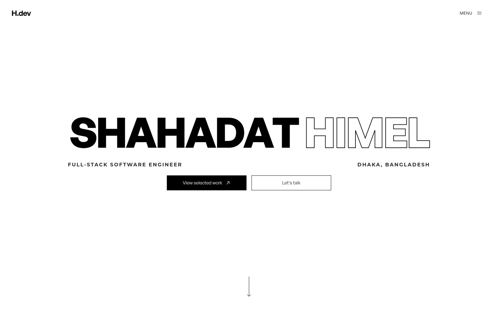

# H.dev — Full-Stack Software Engineer Portfolio

A monochrome, motion-driven portfolio for **Shahadat Himel**, a Full-Stack Software Engineer with 4+ years of experience based in Dhaka, Bangladesh. It is built to win freelance projects and remote roles by demonstrating motion craftsmanship in the first seconds — the interface itself is the proof.

[Live site](https://h-dev-portfolio-v0.vercel.app) · [Source code](https://github.com/dev-himel-0o0/h.dev-portfolio-v0) · [Product notes](./PRODUCT.md)



## Overview

A pure black-and-white, editorial portfolio: white canvas, black type, neutral grays, and hairline borders (`border-black/10`) — no gradients, accent colors, or decorative noise. General Sans carries the display type; Montserrat handles body copy, labels, and numbers. Large typography sets the pace, generous whitespace does the framing, and GSAP-driven motion carries the experience.

The page runs from a preloader through the hero, about, selected work, services, stack, and process sections to a contact footer. A glass navbar, a fullscreen numbered menu, a desktop-only custom cursor, and a page-transition curtain sit on top of that foundation.

This is a static, frontend-only Next.js project. There is no backend, database, or API layer.

## Problems solved

- **Proof over claims.** A portfolio that _says_ it has motion craft is easy to ignore. This one makes the claim through the interface itself, so the first interaction is the evidence.
- **A short evaluation window.** Freelance clients and recruiters decide quickly. The preloader, hero, and project work are sequenced to establish tone and credibility before the visitor has to read a paragraph.
- **Motion without an accessibility tax.** Scroll and entrance effects are capability-gated: reduced-motion visitors get static, readable content; touch devices skip smooth-scroll and cursor effects.
- **Mobile as a first-class surface.** Touch scrolling stays native, the custom cursor is never rendered, and scroll-driven sections have lighter mobile paths instead of scaled-down desktop choreography.
- **Content that cannot drift or fabricate.** Every project, service, stack item, process step, stat, and social link lives in `src/lib/data.ts`. Placeholder entries are explicit until real content is supplied.

## Features

- **Cinematic preloader** — flip-fade words on a five-band black curtain, with a progress hairline and a wipe into the hero.
- **Editorial hero** — shuffle-in name treatment, filled and outlined display type, scroll parallax, and two clear calls to action.
- **Glass navbar and fullscreen menu** — a scroll-triggered glass bar plus a numbered menu with three dark curtain folds and a single GSAP timeline.
- **Selected work** — stacked editorial project cards that scale back as the next one arrives, with masked image reveals, impact stats, and rolling numbers.
- **Services** — a hover-driven service selector with contained image trails, rolling counts, and keyboard focus support.
- **Stack** — a magic-bento capability grid, masked tech avatars with grayscale-to-color hover, and brand icons.
- **How I Work** — a scroll-progress process timeline with video reveals, animated rails, and number strips; mobile gets a lighter once-only reveal.
- **Contact footer** — an oversized brand reveal masked behind the contact panel, direct email links, socials, and back-to-top.
- **Desktop enhancements** — a custom circle cursor that expands over interactive targets, emits sparks, and shows a keyboard-focus halo. It is dynamically imported and never rendered on touch devices.
- **Page transitions and 404** — a shared curtain wipe covers forward, back/forward, and direct-load navigation on inner routes, while the home preloader handles the first visit; reduced-motion visitors get instant transitions.
- **Tested behavior** — Playwright specs cover the home page, responsive layouts, cursor behavior, navigation transitions, and the 404 page on desktop and mobile.

## Tech stack

| Area       | Tools                                                        |
| ---------- | ------------------------------------------------------------ |
| Framework  | Next.js 16.2 (App Router), React 19.2, TypeScript 5          |
| Styling    | Tailwind CSS v4, shadcn conventions, Base UI, tw-animate-css |
| Motion     | GSAP 3.15 + `@gsap/react`, ScrollTrigger, Lenis, Motion      |
| Icons      | Phosphor Icons, React Icons                                  |
| Media      | Next Image, native video                                     |
| Testing    | Playwright                                                   |
| Deployment | Vercel                                                       |

## Why these technologies

- **Next.js 16 + React 19** — the site is a single page plus a 404, so the App Router keeps routing and metadata simple while static rendering keeps delivery fast. `next/font` self-hosts General Sans and loads Montserrat without layout shift, `next/image` handles project media, and the React Compiler is enabled.
- **TypeScript** — the content layer has real shapes (`Project`, `Service`, `StackItem`, `ProcessStep`), so placeholder data and future real data are checked at build time instead of discovered in the browser.
- **Tailwind CSS v4 + Base UI** — Tailwind's CSS-first tokens keep the monochrome scale, gutters, and responsive rules in one system. Base UI provides accessible behavior without imposing a visual theme; shadcn conventions keep the owned components consistent.
- **GSAP + ScrollTrigger** — GSAP handles the timelines, scroll-linked sequences, and entrance choreography. `useGSAP` scopes and cleans up animations, while `gsap.matchMedia()` keeps responsive and reduced-motion branches explicit.
- **Lenis** — it provides inertial scrolling without replacing the native document scroll container. Its RAF loop is driven by the GSAP ticker and synced with `ScrollTrigger.update`, so the two systems share one frame loop.
- **Motion** — reserved for hover, tap, and small state changes where a declarative spring is clearer than a timeline. `MotionConfig` respects the visitor's reduced-motion preference in production.
- **Phosphor Icons + React Icons** — Phosphor covers interface actions; React Icons supplies brand marks and technology logos. Both are imported per icon so unused glyphs stay out of the bundle.
- **Playwright** — end-to-end tests exercise the real site at desktop and Pixel 7 viewports, with the dev server started automatically and full-motion behavior enabled.
- **Vercel** — the default Next.js build, preview deployments, and static delivery require no custom server or environment configuration.

## Dependencies

All dependencies are pinned in [`package-lock.json`](./package-lock.json).

### Runtime

| Package                    | Version    | Purpose                                                |
| -------------------------- | ---------- | ------------------------------------------------------ |
| `@base-ui/react`           | `^1.6.0`   | Accessible unstyled UI primitives                      |
| `@gsap/react`              | `^2.1.2`   | `useGSAP` hook and animation cleanup                   |
| `@phosphor-icons/react`    | `^2.1.10`  | Interface icons                                        |
| `class-variance-authority` | `^0.7.1`   | Variant API for the button primitive                   |
| `clsx`                     | `^2.1.1`   | Conditional class composition                          |
| `gsap`                     | `^3.15.0`  | Timeline and scroll animation engine                   |
| `lenis`                    | `1.3.23`   | Inertial smooth scrolling                              |
| `motion`                   | `^12.43.0` | Hover and micro-interactions                           |
| `next`                     | `16.2.12`  | Framework, routing, images, and fonts                  |
| `next-devtools-mcp`        | `^0.4.0`   | Next.js devtools MCP bridge                            |
| `ogl`                      | `^0.0.11`  | WebGL renderer for the ferrofluid background component |
| `react`                    | `19.2.4`   | UI runtime                                             |
| `react-dom`                | `19.2.4`   | DOM renderer                                           |
| `react-icons`              | `^5.7.0`   | Brand and technology icons                             |
| `tailwind-merge`           | `^3.6.0`   | Conflict-free class merging                            |
| `tw-animate-css`           | `^1.4.0`   | CSS animation utilities                                |

### Development

| Package                       | Version   | Purpose                             |
| ----------------------------- | --------- | ----------------------------------- |
| `@playwright/test`            | `^1.62.1` | End-to-end test runner              |
| `@tailwindcss/postcss`        | `^4`      | Tailwind PostCSS pipeline           |
| `@types/node`                 | `^20`     | Node.js type definitions            |
| `@types/react`                | `^19`     | React type definitions              |
| `@types/react-dom`            | `^19`     | React DOM type definitions          |
| `babel-plugin-react-compiler` | `1.0.0`   | React Compiler transform            |
| `eslint`                      | `^9`      | Linting                             |
| `eslint-config-next`          | `16.2.12` | Next.js ESLint rules                |
| `eslint-config-prettier`      | `^10.1.8` | Disables formatting rules in ESLint |
| `prettier`                    | `^3.9.6`  | Code formatting                     |
| `prettier-plugin-tailwindcss` | `^0.8.1`  | Tailwind class ordering             |
| `shadcn`                      | `^4.16.1` | Component registry CLI              |
| `tailwindcss`                 | `^4`      | Styling engine                      |
| `typescript`                  | `^5`      | Type checking                       |

## Getting started

### Prerequisites

- Node.js **20.9.0 or newer** (required by Next.js 16)
- npm
- Git

No environment variables are required for local development or production.

### Run locally

1. Clone the repository.

   ```bash
   git clone https://github.com/dev-himel-0o0/h.dev-portfolio-v0.git
   cd h.dev-portfolio-v0
   ```

2. Install dependencies from the lockfile.

   ```bash
   npm ci
   ```

   Use `npm install` instead if you are intentionally updating dependencies.

3. Start the development server.

   ```bash
   npm run dev
   ```

4. Open [http://localhost:3000](http://localhost:3000).

5. Verify the production build when needed.

   ```bash
   npm run build
   npm run start
   ```

### Run the tests

Install the Chromium browser once, then run the suite. The Playwright config starts the dev server automatically and reuses an existing server on port 3000.

```bash
npx playwright install chromium
npm run test:e2e
```

Use `npm run test:e2e:ui` for the interactive runner or `npm run test:e2e:headed` to watch the browser.

## Scripts

| Command                   | Description                           |
| ------------------------- | ------------------------------------- |
| `npm run dev`             | Start the development server          |
| `npm run build`           | Create a production build             |
| `npm run start`           | Serve the production build            |
| `npm run lint`            | Lint `src` and `e2e`                  |
| `npm run format`          | Format the project with Prettier      |
| `npm run format:check`    | Check formatting without writing      |
| `npm run test:e2e`        | Run Playwright end-to-end tests       |
| `npm run test:e2e:ui`     | Run Playwright in UI mode             |
| `npm run test:e2e:headed` | Run Playwright with a visible browser |

## Project structure

```text
.
├── docs/readme/              # README cover image
├── e2e/                      # Playwright specs (desktop + mobile)
├── public/
│   ├── img/                  # Project, service, and brand imagery
│   └── videos/               # Process stills and clips
├── src/
│   ├── app/                  # App Router entry (layout, page, 404, globals)
│   ├── components/
│   │   ├── home-experience.tsx  # Composes the single-page experience
│   │   ├── sections/            # Preloader, navbar, hero, work, services, stack, process, footer
│   │   └── ui/                  # Reusable animation and interaction primitives
│   ├── fonts/                # Self-hosted General Sans woff2 files
│   └── lib/
│       ├── data.ts           # Single source of truth for all site content
│       ├── navigation.ts     # Navigation and transition state helpers
│       └── utils.ts          # Shared utilities
├── PRODUCT.md                # Audience, positioning, and product constraints
├── AGENTS.md                 # Design system and build conventions
└── playwright.config.ts      # Desktop Chrome + Pixel 7 test projects
```

## Content

All copy, projects, services, stack items, process steps, stats, and social links live in [`src/lib/data.ts`](./src/lib/data.ts). Update that file rather than editing components.

Some entries are deliberate placeholders until real content is supplied — projects, services, stack details, and social URLs. Real projects, clients, metrics, and testimonials must never be invented.

Design tokens, gutters, and global styles are defined in [`src/app/globals.css`](./src/app/globals.css).

## Challenges faced

- **Preloader-to-hero handoff.** A hard load needs the full preloader sequence, while a client-side arrival already has the curtain wipe as its entrance. The two paths share one hero reveal without flashing content or playing the preloader twice.
- **Two scroll systems, one frame loop.** Lenis owns interpolation, but ScrollTrigger needs to update on every Lenis scroll. Driving Lenis from the GSAP ticker and disabling lag smoothing keeps pinning and scroll-linked timelines in sync; native touch scrolling is left alone instead of running a second RAF loop on phones.
- **Desktop effects without mobile cost.** The custom cursor, image trails, and pointer-following visuals are gated behind `(hover: hover) and (pointer: fine)`. The cursor is dynamically imported, and loops pause when the tab is hidden, so touch sessions never pay for effects they cannot use.
- **Reduced motion without empty sections.** Animation setup often hides content before revealing it. Reduced-motion branches set the final visible state immediately, and `gsap.matchMedia()` / `MotionConfig` keep those paths declarative rather than scattering exceptions through the components.
- **Hairline timelines.** The process rails sit on fractional pixel positions and can rasterize unevenly. The build snaps each rail to the device pixel ratio, recalculates after fonts load and on resize, and replaces per-scroll progress on mobile with a simpler once-only reveal.

## Accessibility & performance

- `prefers-reduced-motion` support — scroll, entrance, and page-transition animations collapse to their final states so content stays visible.
- The custom cursor is desktop-only, never rendered on touch devices, and is dynamically imported.
- Keyboard navigation, focus-visible states, and a keyboard-focus halo are built into the menu and interactive surfaces.
- Animation loops pause while the tab is hidden.
- Smooth scrolling is limited to fine pointers with motion enabled; touch devices keep native scrolling.
- Responsive behavior is tested at desktop and mobile viewports, not treated as an afterthought.
- The site is static and frontend-only, so there is no API latency or server to maintain.

## Deployment

The site deploys on Vercel with the default Next.js settings. Import the repository, keep the project root, and deploy — no custom environment variables or build overrides are required.

## Links

| Resource          | URL                                                                                                |
| ----------------- | -------------------------------------------------------------------------------------------------- |
| Live site         | [h-dev-portfolio-v0.vercel.app](https://h-dev-portfolio-v0.vercel.app)                             |
| Source code       | [github.com/dev-himel-0o0/h.dev-portfolio-v0](https://github.com/dev-himel-0o0/h.dev-portfolio-v0) |
| Product notes     | [`PRODUCT.md`](./PRODUCT.md)                                                                       |
| Build conventions | [`AGENTS.md`](./AGENTS.md)                                                                         |
| API reference     | Not applicable — this is a static, frontend-only portfolio.                                        |

## License

MIT © 2026 Shahadat Himel. See [LICENSE](./LICENSE).
